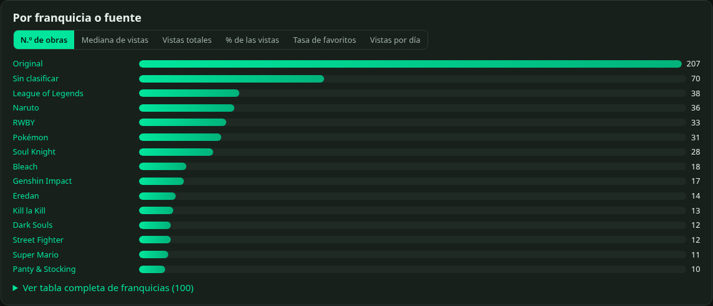
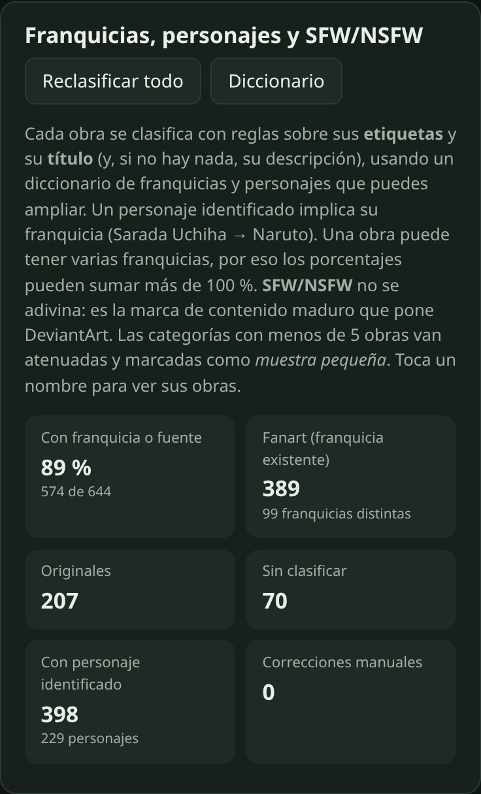
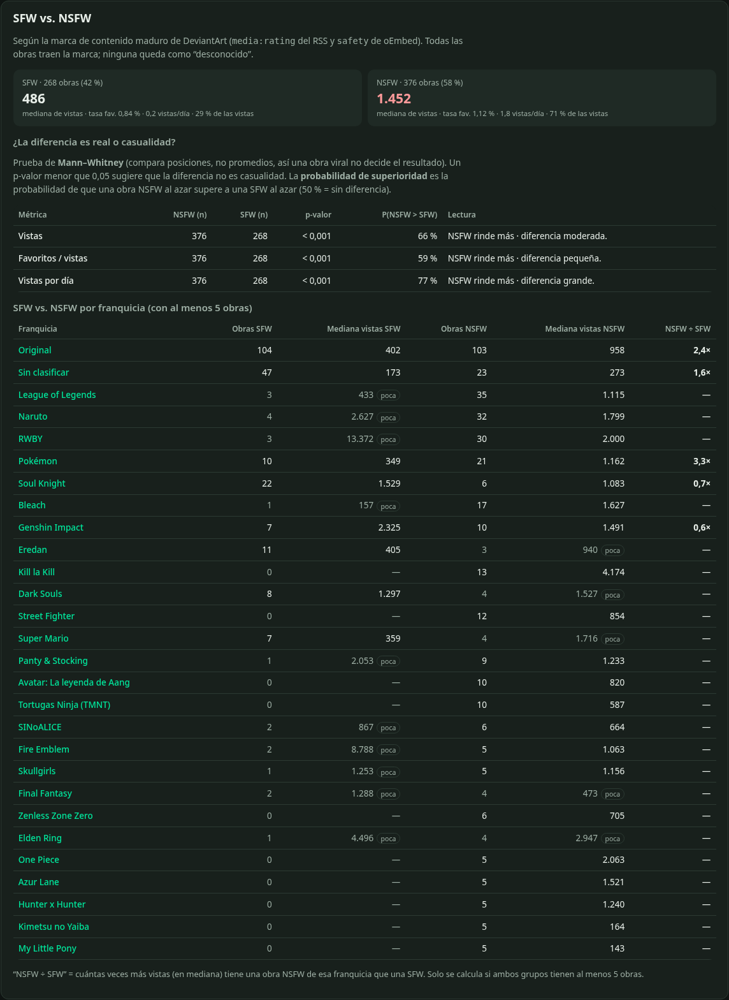
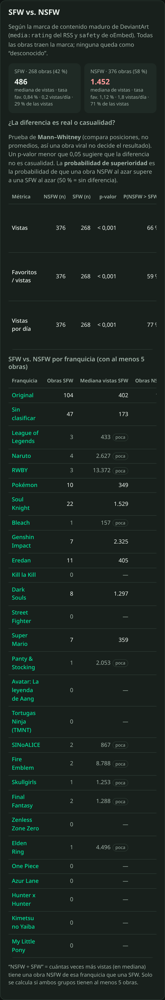
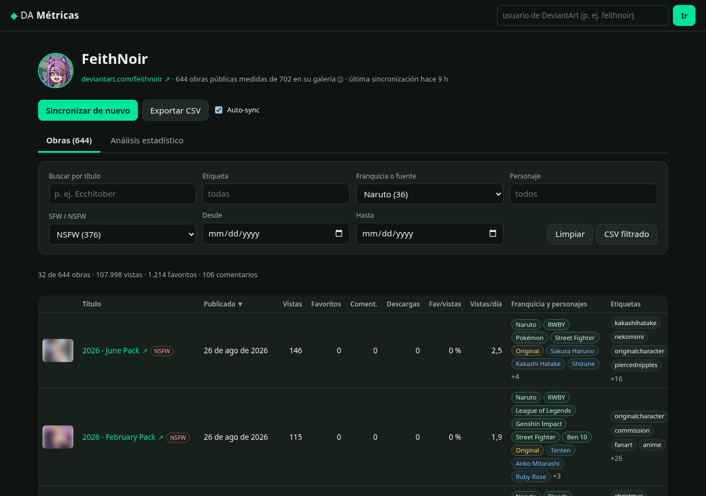
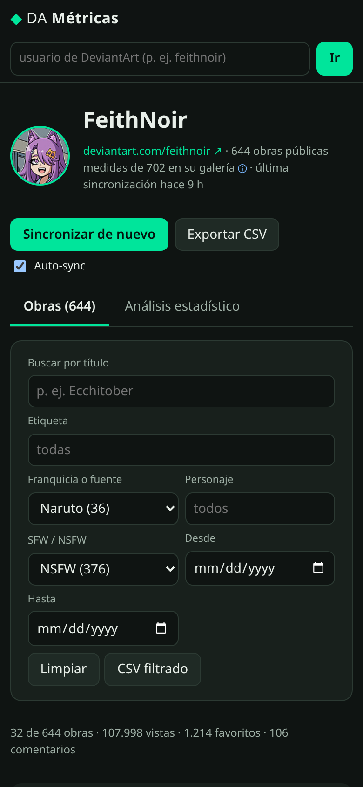
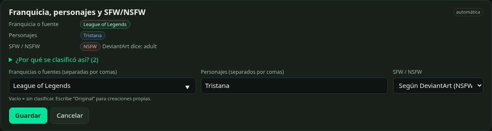
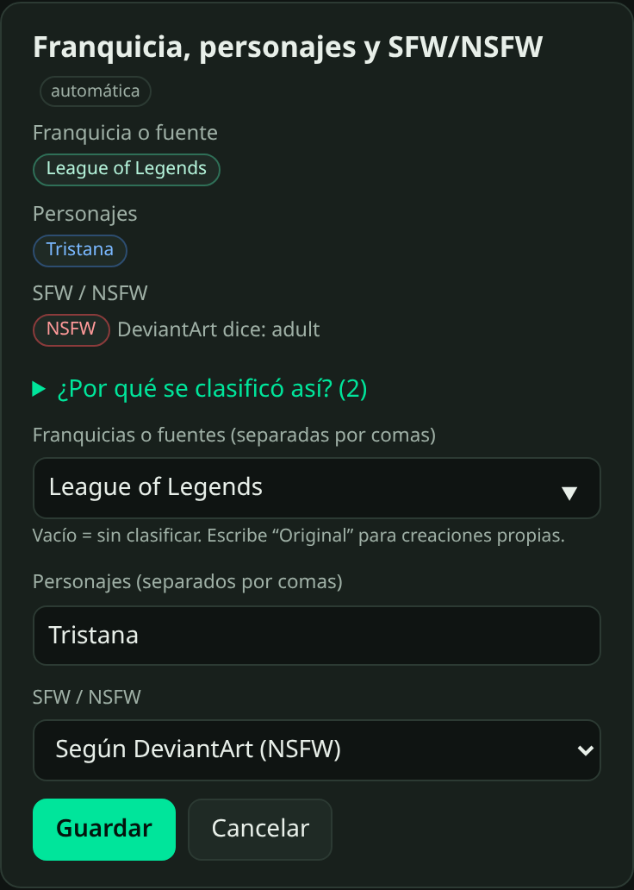
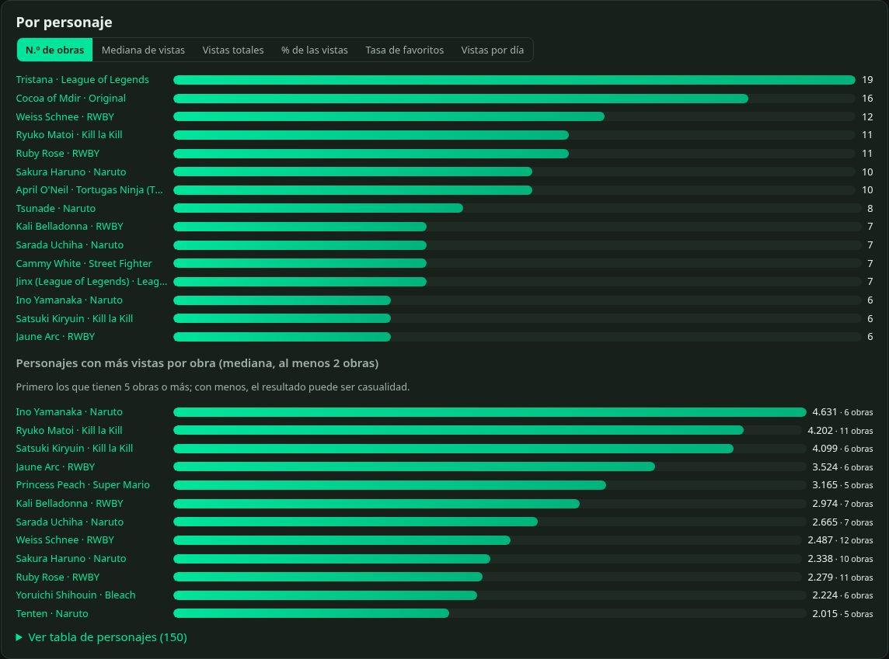
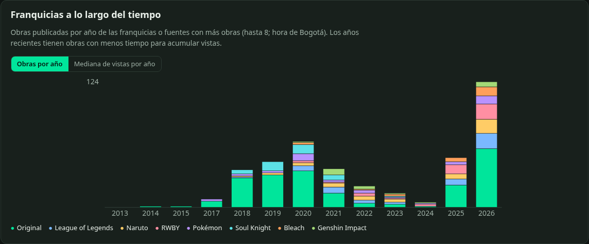

# DA Métricas

Aplicación full-stack para **medir el rendimiento público de las obras de un artista de DeviantArt**: sincroniza su galería, guarda un historial de métricas en SQLite y presenta un **análisis estadístico explicado en español sencillo** (descriptivos, interacción, atípicos, correlaciones, etiquetas, fechas, antigüedad y crecimiento), ahora también **por franquicia o fuente** (Naruto, Bleach, One Piece, Warframe… u *Original*), **por personaje** (Sakura Haruno, Sarada Uchiha…) y **SFW vs. NSFW**.

Pensada para seguir la cuenta [feithnoir](https://www.deviantart.com/feithnoir), pero funciona con **cualquier usuario público**.
**No usa la API oficial de DeviantArt** (ni OAuth ni `api/v1/oauth2`): solo fuentes públicas, gratuitas y sin claves.

> Proyecto personal de **Feith Noir**: Angular 22 + Node.js 24 + TypeScript + Fastify + SQLite.

| Escritorio (1280 px) | Móvil (390 px) |
| --- | --- |
|  |  |
|  |  |
|  |  |
|  |  |
|  |  |
|  |  |
|  |  |
|  |  |
|  |  |

## Qué hace

- **Sincroniza** un usuario: recorre su galería pública y, para cada obra, guarda título, URL, miniatura, fecha de publicación, **favoritos (likes)**, **vistas**, **comentarios**, **descargas** y **etiquetas**.
- **Guarda un snapshot por obra en cada sincronización** (tabla `snapshots`), para analizar el crecimiento en el tiempo.
- **Sincronización automática** opcional (por defecto una vez al día; mínimo cada 6 horas, para no sobrecargar a DeviantArt).
- **Tabla de obras** ordenable y filtrable (título, etiqueta, **franquicia, personaje, SFW/NSFW**, rango de fechas) con enlaces al original y **exportación a CSV** (respeta los filtros e incluye franquicias, personajes y SFW/NSFW).
- **Clasificación por franquicia o fuente, personaje y SFW/NSFW** con reglas y un diccionario ampliable (sin IA ni servicios externos), **corrección manual por obra** y botón **Reclasificar todo** (no vuelve a descargar nada). Ver [Franquicias, personajes y SFW/NSFW](#franquicias-personajes-y-sfwnsfw).
- **Análisis estadístico** por artista y **detalle por obra** (percentiles frente a las demás obras, puesto, historial con gráfico).
- Estados claros de **carga, vacío y error**: avisa si el usuario no existe o no tiene obras públicas.

## Fuentes de datos (verificadas en vivo el 24 de octubre de 2026)

| Fuente | URL | Qué trae | Qué NO trae |
| --- | --- | --- | --- |
| **RSS público de la galería** | `https://backend.deviantart.com/rss.xml?type=deviation&q=gallery:USUARIO&offset=N` | Lista de obras: título, URL (con el id), fecha (`pubDate`), miniaturas, autor, clasificación (`media:rating`) | Estadísticas; las etiquetas (`media:keywords`) vienen casi siempre vacías |
| **oEmbed público** | `https://backend.deviantart.com/oembed?url=URL_DE_LA_OBRA` | `community.statistics._attributes`: **vistas, favoritos, comentarios, descargas**; **etiquetas** (`tags`), fecha (`pubdate`), título, autor | — |
| **Página pública de la obra** (respaldo) | `https://www.deviantart.com/USUARIO/art/...` | El JSON embebido `window.__INITIAL_STATE__` con `stats` (vistas, favoritos, comentarios, descargas) y etiquetas | Se usa solo si falla el oEmbed (pesa ~1 MB por obra) |
| **Página pública de la galería** | `https://www.deviantart.com/USUARIO/gallery` | Si el usuario existe (404 si no), nombre visible, avatar y el **total de la carpeta “All”** | — |

Cómo se combinan: **RSS** (lista completa, paginando con el enlace `rel="next"`) → **oEmbed** por obra (métricas + etiquetas) → **página de la obra** solo como respaldo. La galería HTML se pide una vez por sincronización para saber si el usuario existe y cuántas obras dice tener.

### Límites conocidos (sin inventar datos)

- **Contenido premium / de pago no es público**: el RSS no lo lista. Para feithnoir, la galería dice **702** obras en “All” y el RSS expone **644**; las 58 restantes son, sobre todo, carpetas “Patreon Imagenset” de pago. Esas obras **no se miden** (la interfaz muestra “644 de 702”).
- **Páginas del RSS irregulares**: el `offset` avanza de 60 en 60, pero cada página trae menos de 60 ítems (filtra lo no público). Por eso se sigue el enlace `rel="next"` en vez de contar ítems.
- **Las métricas son acumuladas** (totales a la fecha). No hay vistas por día oficiales: el crecimiento se calcula entre snapshots propios, así que solo existe desde tu segunda sincronización.
- **Miniaturas**: para obras para adultos, DeviantArt sirve miniaturas difuminadas a usuarios sin sesión; la app muestra lo que es público.
- **Descargas**: el oEmbed puede ir un poco por detrás de la página (se vio `downloads: 0` en oEmbed y `1` en la página para la misma obra).
- **No hay datos públicos de**: vistas por día, procedencia del tráfico, “privately collected” en oEmbed, ni seguidores ganados por obra.
- **Cloudflare**: desde el servidor de desarrollo no hubo bloqueos (RSS, oEmbed y HTML respondieron 200). Si DeviantArt presenta un desafío de Cloudflare, la app **lo detecta, detiene la sincronización y lo informa**: no intenta saltárselo.

## Franquicias, personajes y SFW/NSFW

Tres dimensiones nuevas de análisis, calculadas **solo con datos públicos ya descargados** y reglas transparentes (no hay IA, ni API de pago, ni servicios externos).

### SFW / NSFW: la marca de DeviantArt, no una suposición

- Fuente principal: **`media:rating`** del RSS (`adult` / `nonadult`). Se contrasta con **`safety`** del oEmbed (`adult` / `nonadult`) y, en el respaldo HTML, con `isMature` / `matureLevel`.
- `adult`, `mature`, `moderate`, `strict` → **NSFW**; `nonadult`, `general`… → **SFW**; cualquier otra cosa o la ausencia del dato → **“desconocido”** (se cuenta y se informa; nunca se adivina).
- Con feithnoir, el RSS y el oEmbed coinciden en **644 de 644** obras: 376 NSFW, 268 SFW, 0 desconocidas.

### Franquicia o fuente y personajes: reglas + diccionario

El diccionario está en [`server/src/classifier/dictionary.json`](server/src/classifier/dictionary.json) (≈125 franquicias y ≈600 personajes; una franquicia por línea para que los cambios se lean bien en Git). El clasificador ([`classify.ts`](server/src/classifier/classify.ts)) busca en las **etiquetas** y el **título** de cada obra:

- **Etiquetas en todas sus formas**: se comparan “compactadas” (minúsculas, sin tildes, espacios ni signos), así `Sakura Haruno`, `sakuraharuno`, `sakura_haruno` y el orden japonés `harunosakura` coinciden. También `narutofanart`, `fanartnaruto`, `nsfwnaruto` (sufijos y prefijos configurables) y personaje + franquicia en una sola etiqueta (`saradauchihanaruto`). Los alias de 6+ letras se buscan además dentro de etiquetas más largas.
- **Título**: por frase completa (`Konoha Mean Girls` → Naruto; `RWBY - Kali at Beach` → RWBY y Kali Belladonna).
- **Personaje → franquicia**: si aparece `saradauchiha`, la obra es de Naruto aunque no tenga la etiqueta `naruto`.
- **Multi-etiqueta**: crossovers y *packs* reciben todas sus franquicias y personajes.
- **Nombres ambiguos** (`weak`): “Sakura”, “Weiss”, “Ash”… solo cuentan si la obra ya tiene esa franquicia, y nunca como subcadena (evita que *Sakura* de Street Fighter caiga en Naruto). Los nombres calificados (`Raven (Teen Titans)`) no generan alias sueltos peligrosos. Siglas con `=` (`=lol`, `=feh`) solo coinciden exactas.
- **Original**: etiquetas `oc`, `originalcharacter`, `ocart`…, o los OC y series propios del artista (`artists.feithnoir`, solo se aplican a ese usuario). Un `oc` de relleno en un fanart de una sola franquicia con personaje identificado **no** se cuenta como Original.
- **Descripción**: solo como **respaldo** cuando etiquetas y título no dan nada (las descripciones suelen mencionar otras obras o promociones), y nunca para nombres ambiguos.
- **Sin señales → “Sin clasificar”** (no se inventa una franquicia). Cada obra guarda la **evidencia** (“etiqueta `sakuraharuno`”, “deducida del personaje”), visible en su página.

### Correcciones manuales y diccionario propio

- En la página de cada obra: **Corregir clasificación** (franquicias, personajes y SFW/NSFW). Las correcciones se guardan en SQLite (`classification_overrides`), **mandan sobre lo automático** y sobreviven a cualquier reclasificación. *Volver a lo automático* las borra.
- En **/diccionario** puedes consultar el diccionario y guardar una **ampliación en JSON** (se fusiona con el incorporado; validación con mensajes en español). Al guardarla se **reclasifican todas las obras** de todos los artistas sin volver a descargar nada.
- Formato:

```json
{
  "franchises": [
    { "name": "Mi franquicia", "aliases": ["mifranquicia", "=MF"],
      "characters": ["Personaje Uno", { "name": "Personaje Dos", "aliases": ["pdos"], "weak": ["Dos"] }] }
  ],
  "artists": { "feithnoir": { "originalSeries": ["Woodheart Cafe"], "originalCharacters": [{ "name": "Cocoa of Mdir", "aliases": ["Cocoa"] }] } }
}
```

- Cada clasificación guarda la **huella** del diccionario y de la versión de las reglas; si cambian, las obras se reclasifican solas la próxima vez que se consultan. También se reclasifica al terminar cada sincronización.

### Migración de la base

El esquema se versiona con `PRAGMA user_version`. La migración 1 agrega `deviations.description` y las tablas `classifications` y `classification_overrides` **sin tocar** obras, snapshots ni sincronizaciones. Las descripciones de las obras ya guardadas se recuperan de la caché HTTP del RSS (sin descargar nada) y todo se clasifica al arrancar.

### Análisis

Por franquicia, por personaje y por SFW/NSFW: n.º de obras y cuota, vistas totales y % de las vistas, mediana y media de vistas, favoritos y comentarios, tasa de favoritos, vistas por día, % NSFW y obras más vistas. Además:

- **SFW vs. NSFW** con la prueba de **Mann–Whitney** (p-valor y probabilidad de superioridad) sobre vistas, tasa de favoritos y vistas por día.
- **SFW vs. NSFW por franquicia** (cociente de medianas solo si ambos grupos tienen ≥ 5 obras).
- **Personajes con más vistas por obra** (mediana, ≥ 2 obras; primero los de muestra suficiente).
- **Franquicias por año**: obras por año (columnas apiladas) y mediana de vistas por año (mapa de calor).
- Las categorías con **menos de 5 obras** se atenúan y se marcan “muestra pequeña”. Al ordenar por una métrica se omiten de los gráficos (siguen en las tablas).

### Límites de la clasificación

- Depende de cómo el artista etiqueta y titula: obras sin etiquetas ni título descriptivo (bocetos, prácticas, retos como *Magical March*) quedan **Sin clasificar**. Corrígelas a mano o amplía el diccionario.
- Las etiquetas ruidosas de algunos *packs* o promociones (p. ej. una etiqueta de otra franquicia añadida por alcance) se clasifican tal cual: la evidencia lo muestra y la corrección manual lo arregla.
- Un OC de otro artista (*art trades*) cuenta como **Original**, no como franquicia.
- El contenido premium que el RSS no lista no se clasifica (no se mide).

## Respeto por DeviantArt

- **User-Agent descriptivo** (`da-metricas/1.0 (...)`, configurable con `USER_AGENT`).
- **Concurrencia 1–2** y **pausa mínima** entre peticiones (600 ms por defecto). Una galería de ~650 obras tarda unos 6–7 minutos, a propósito.
- **Reintentos con backoff exponencial** ante 429/403/5xx, respetando `Retry-After`.
- **Caché en SQLite** (30 min por defecto) para no repetir descargas en sincronizaciones seguidas; el RSS de la primera página y el oEmbed de cada sincronización se piden frescos para que los snapshots sean reales.
- **Sincronización automática como máximo cada 6 horas.**
- Lee únicamente información **pública**; no inicia sesión ni guarda credenciales. Revisa y respeta los [Términos de servicio de DeviantArt](https://www.deviantart.com/about/policy/service/); úsala para seguimiento personal y con moderación.

## Arquitectura

```
da-metricas/
├── server/                     # API Node.js 24 + TypeScript (Fastify) + SQLite (node:sqlite)
│   ├── src/
│   │   ├── parsers/            # rss.ts, oembed.ts, page.ts (__INITIAL_STATE__), text.ts
│   │   ├── http.ts             # cliente “amable”: UA, concurrencia, pausas, backoff, caché, Cloudflare
│   │   ├── deviantart.ts       # perfil, lista (RSS) y detalle (oEmbed → página)
│   │   ├── sync.ts             # orquesta la sincronización y guarda snapshots
│   │   ├── db.ts               # esquema, migraciones (PRAGMA user_version) y consultas SQLite
│   │   ├── stats.ts            # estadística pura: media, mediana, cuantiles, Pearson, Spearman, IQR…
│   │   ├── analysis.ts         # análisis por artista y por obra + franquicias, personajes, SFW/NSFW
│   │   ├── classifier/         # classify.ts (reglas) + dictionary.json (franquicias y personajes)
│   │   ├── classification.ts   # reclasificación, diccionario propio y correcciones manuales
│   │   ├── scheduler.ts        # sincronización automática
│   │   ├── csv.ts              # exportación CSV (BOM UTF-8, anti-fórmulas)
│   │   ├── app.ts / index.ts   # rutas REST y arranque
│   │   └── cli-sync.ts, check-sources.ts
│   ├── data/da-metricas.db     # base SQLite (se crea sola; no se versiona)
│   └── test/                   # Vitest + fixtures reales recortadas
├── web/                        # Angular 22 (standalone, signals, sin zone.js), gráficos SVG propios
│   └── src/app/
│       ├── pages/              # inicio, artista (obras/análisis), clasificación, detalle de obra, diccionario, opciones
│       └── charts/             # barras, columnas, columnas apiladas, líneas y dispersión (sin librerías)
├── scripts/screenshots.mjs     # capturas con Playwright
└── .github/workflows/ci.yml    # lint, tests y build
```

Tablas SQLite: `artists`, `deviations`, `syncs`, `snapshots` (una fila por obra y sincronización), `classifications` (automática, con evidencia y huella del diccionario), `classification_overrides` (correcciones manuales), `settings` (incluye el diccionario propio) y `http_cache`.

## Requisitos e instalación

- Node.js **24** (usa el módulo integrado `node:sqlite`; no hay dependencias nativas).
- Chrome/Chromium solo para generar capturas.

```bash
npm install
npm run build          # compila Angular y el servidor
npm start              # http://localhost:3100 (sirve la API y la web)
```

Desarrollo con recarga: `npm run dev` (API en `:3100`, Angular en `:4300` con proxy a `/api`).

`npm start` es **multiplataforma** (Windows, Linux y macOS): el workspace `server` arranca con `node start.mjs`, que fija `NODE_ENV=production` sin depender de la sintaxis `VAR=valor` de shells Unix (que falla en `cmd.exe` de Windows).

### Scripts

| Script | Qué hace |
| --- | --- |
| `npm run dev` | API (tsx watch) + Angular dev server |
| `npm run build` | Compila web y servidor |
| `npm start` | Producción (Windows/Linux/macOS): API + web en el puerto `PORT` (3100) vía `server/start.mjs` |
| `npm test` | Tests del servidor (Vitest) y de la web (Angular + Vitest) |
| `npm run lint` | ESLint + `tsc --noEmit` |
| `npm run sync -- feithnoir` | Sincroniza un usuario desde la terminal |
| `npm run check:sources -- feithnoir` | Comprueba en vivo que RSS, oEmbed y la galería responden con el formato esperado |
| `npm run screenshots` | Regenera `docs/screenshots/` (con el servidor corriendo) |

### Variables de entorno

| Variable | Por defecto | Uso |
| --- | --- | --- |
| `PORT` / `HOST` | `3100` / `0.0.0.0` | Servidor |
| `DB_FILE` | `server/data/da-metricas.db` | Base SQLite |
| `USER_AGENT` | `da-metricas/1.0 (...)` | Cabecera enviada a DeviantArt |
| `DA_CONCURRENCY` | `2` (máx. 2) | Peticiones simultáneas |
| `DA_DELAY_MS` | `600` (mín. 250) | Pausa mínima entre peticiones |
| `DA_MAX_RETRIES` | `4` | Reintentos ante 429/403/5xx |
| `CACHE_TTL_MINUTES` | `30` | Vida de la caché HTTP |
| `TZ_ANALYSIS` | `America/Bogota` | Zona para agrupar por mes, día y hora |

## API REST

| Método y ruta | Descripción |
| --- | --- |
| `GET /api/health` | `{ ok: true }` |
| `GET /api/artists` | Artistas guardados con su número de obras |
| `GET /api/artists/:usuario` | Artista, si hay una sincronización en curso y las últimas 10 sincronizaciones. `404` si aún no hay datos |
| `PATCH /api/artists/:usuario` | `{ "autoSync": true \| false }` |
| `POST /api/artists/:usuario/sync` | Inicia (o reutiliza) una sincronización. Responde `202` con el registro `sync` |
| `GET /api/syncs/:id` | Progreso: `status` (`running`, `ok`, `partial`, `error`, `not_found`, `empty`), `phase`, `found`, `processed`, `failed`, `message` |
| `GET /api/artists/:usuario/deviations?q=&tag=&franchise=&character=&rating=&from=&to=&sort=&order=` | Obras con sus últimas métricas, `favRate`, `commentRate`, `viewsPerDay`, `franchises`, `characters`, `ratingClass` y `classificationOverridden`. `franchise`/`character` sin distinguir mayúsculas ni tildes (`franchise=Sin clasificar` = sin franquicia); `rating`: `sfw`, `nsfw`, `desconocido`. `from`/`to` en `AAAA-MM-DD` (hora de Bogotá); `sort`: `publishedAt`, `views`, `favourites`, `comments`, `downloads`, `favRate`, `viewsPerDay`, `title` |
| `GET /api/artists/:usuario/analysis` | Análisis completo (ver abajo) |
| `GET /api/artists/:usuario/export.csv?…` | CSV con los mismos filtros |
| `GET /api/deviations/:id` | Obra, historial de snapshots, posición frente a las demás obras del artista y `classification` (automática, evidencia, corrección y efectiva) |
| `PUT /api/deviations/:id/classification` | Corrección manual `{ "franchises"?: [...], "characters"?: [...], "rating"?: "sfw" \| "nsfw" \| "desconocido" }`. Campo omitido = se conserva; `null` = vuelve a lo automático |
| `DELETE /api/deviations/:id/classification` | Borra la corrección manual |
| `POST /api/artists/:usuario/reclassify` | Reclasifica todas sus obras con el diccionario actual (sin descargar nada) y devuelve la cobertura |
| `GET /api/dictionary` | Diccionario efectivo: versión, huella, franquicias con alias y personajes, y la ampliación propia |
| `PUT /api/dictionary/custom` / `DELETE /api/dictionary/custom` | Guarda o borra la ampliación propia (JSON validado) y reclasifica todo |
| `GET /api/settings` / `PUT /api/settings` | Auto-sync: `{ enabled, intervalHours }` (6–168 h). Errores `400` en español |

## Notas del método estadístico

- **Solo obras con métricas** entran en el análisis. Cada métrica usa el último snapshot.
- **Descriptivos**: media, mediana, **desviación estándar muestral** (n − 1), mínimo, máximo, **cuartiles por interpolación lineal** (tipo 7, el de Excel/R/NumPy) e IQR. Las vistas son muy asimétricas, así que la interfaz destaca la **mediana**.
- **Tasas de interacción**: favoritos ÷ vistas y comentarios ÷ vistas, **solo para obras con ≥ 30 vistas** (evita tasas engañosas con muestras diminutas).
- **Atípicos**: vallas de **Tukey** (Q1 − 1,5·IQR, Q3 + 1,5·IQR) sobre vistas, favoritos, tasa de favoritos y vistas por día; se reporta además el **z-score**.
- **Correlación**: **Pearson** (lineal) y **Spearman** (por rangos, con empates promediados) entre vistas, favoritos, comentarios, antigüedad y número de etiquetas. Correlación no implica causalidad.
- **Etiquetas**: media y mediana de vistas/favoritos por etiqueta. Se descartan etiquetas con 1 sola obra y se marcan como **“muestra pequeña”** las que tienen menos de 5.
- **Fechas**: agrupación por mes, año, día de la semana y hora **en hora de Bogotá**. Ojo: los periodos recientes tienen obras con menos tiempo para acumular vistas.
- **Normalización por antigüedad**: vistas (y favoritos) **por día desde la publicación**, con mínimo 1 día.
- **Crecimiento**: diferencia entre el primer y el último snapshot de cada obra, y serie temporal de totales por sincronización terminada.
- **Percentil de una obra**: porcentaje de las obras del artista con un valor menor (los empates cuentan la mitad).
- **Categorías multi-etiqueta** (franquicias y personajes): una obra cuenta en cada una de sus categorías, así que las cuotas pueden sumar más de 100 %. Mínimo de **5 obras** para considerar fiable una categoría.
- **Mann–Whitney U** (SFW vs. NSFW): aproximación normal con corrección por empates y por continuidad, p-valor bilateral, **probabilidad de superioridad** P(NSFW > SFW) y correlación biserial de rangos. Requiere ≥ 3 obras por grupo.

## Resultados reales con feithnoir

Primera sincronización real (24 de octubre de 2026, ~11:14 a. m. hora de Bogotá): **644 obras públicas** (de 702 en la galería), **644/644 con métricas** y 0 fallos, en 395 s.

- Totales: **1.239.464 vistas**, **14.911 favoritos**, **1.514 comentarios**, 333 descargas.
- Top 3 por vistas: *Konoha Mean Girls: Stream Night* (29.165), *RWBY - Kali at Beach* (27.909), *RWBY - Thorns and Crowns* (24.066).
- Vistas por obra: mediana **1.008**, media 1.925 (desv. 2.820): pocas obras muy vistas inflan la media.
- Una obra típica convierte el **0,99 %** de sus vistas en favoritos (mediana).
- Vistas y favoritos: Spearman **0,89** (Pearson 0,82). Las obras más **recientes** tienden a tener **más** vistas (Spearman vistas–antigüedad −0,51).
- Una segunda sincronización ~9 minutos después (644/644, 0 fallos) dejó el primer historial: +22 vistas, sobre todo en las entradas más nuevas de Ecchitober.

### Franquicias, personajes y SFW/NSFW (24 de octubre de 2026, ~8:03 p. m. hora de Bogotá)

- **Cobertura**: **574 de 644 obras (89 %)** tienen franquicia o fuente; **389** son fanart de 99 franquicias distintas, **207** son Original y **70** quedan *Sin clasificar*. 398 obras tienen al menos un personaje identificado (229 personajes distintos).
- **Top franquicias** (obras · mediana de vistas): League of Legends 38 · 1.027; Naruto 36 · 1.910; RWBY 33 · 2.236; Pokémon 31 · 853; Soul Knight 28 · 1.428; Bleach 18 · 1.320; Genshin Impact 17 · 1.664; Eredan 14 · 450; **Kill la Kill 13 · 4.174** (la de más vistas por obra); Dark Souls 12 · 1.297. Original: 207 · 511; Sin clasificar: 70 · 180.
- **Top personajes**: Tristana 19 · 1.262; Cocoa of Mdir (OC) 16 · 151; Weiss Schnee 12 · 2.487; Ryuko Matoi 11 · 4.202; Ruby Rose 11 · 2.279; Sakura Haruno 10 · 2.338; April O'Neil 10 · 587; Tsunade 8 · 1.337; Kali Belladonna 7 · 2.974; Sarada Uchiha 7 · 2.665. Con más vistas por obra (≥ 5 obras): Ino Yamanaka (4.631), Ryuko Matoi (4.202), Satsuki Kiryuin (4.099).
- **SFW vs. NSFW**: NSFW 376 obras, mediana **1.452** vistas (71 % de todas las vistas); SFW 268, mediana **486**. Mann–Whitney: p < 0,001 en vistas (P(NSFW > SFW) = 66 %), en vistas por día (77 %) y en tasa de favoritos (59 %; 1,12 % vs. 0,84 %).
- **Revisión manual** de 2 muestras aleatorias de 20 obras: 18/20 y 19/20 correctas en franquicia; los fallos (un OC mal ubicado, dos personajes ambiguos sin detectar) se corrigieron en el diccionario y quedaron como tests.
- **Otro artista** ([metour](https://www.deviantart.com/metour), 13 obras): 13/13 sincronizadas y 13/13 con franquicia (Naruto, Disney, Ranma ½), todas SFW según DeviantArt.

## Tests

- **Servidor (Vitest)**: parsers con **fixtures de respuestas reales** recortadas (`server/test/fixtures`), funciones estadísticas con valores conocidos, cliente HTTP (reintentos, Cloudflare, caché, concurrencia), análisis, CSV y rutas de la API con un DeviantArt simulado a partir de las fixtures (incluye el respaldo HTML, usuario inexistente y usuario sin obras).
- **Clasificación (Vitest)**: alias y formas de etiqueta (`sakuraharuno`, `sakura_haruno`, `harunosakura`), multi-franquicia, personaje → franquicia, Original, sin clasificar, nombres ambiguos, descripción como respaldo, SFW/NSFW desde `media:rating`/`safety`, validación y fusión del diccionario, **migración** v0 → v1 sin pérdida de datos, correcciones manuales (persisten, mandan y se borran con la obra), Mann–Whitney con valores conocidos y análisis por categoría.
- **Web (Angular + Vitest)**: formato es-CO, tabla de obras (filtros por título, etiqueta, franquicia, personaje y SFW/NSFW, orden, CSV), página de artista, sección de franquicias/personajes/SFW-NSFW (reclasificar, enlaces que filtran), tarjeta de corrección manual, página del diccionario y gráficos.

## Licencia

MIT. Proyecto no afiliado a DeviantArt; “DeviantArt” es marca de sus respectivos dueños.
