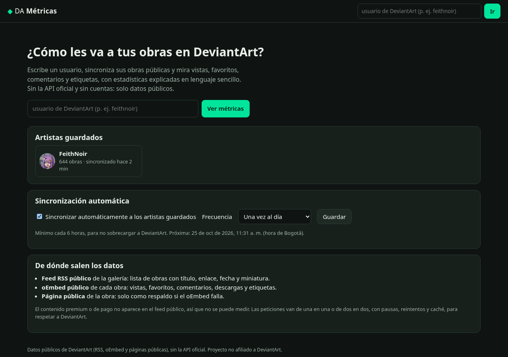
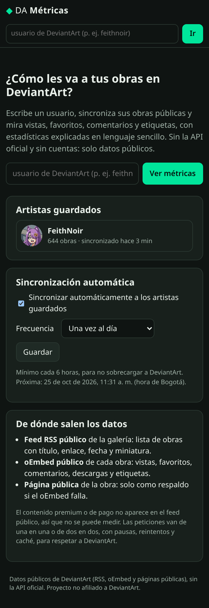
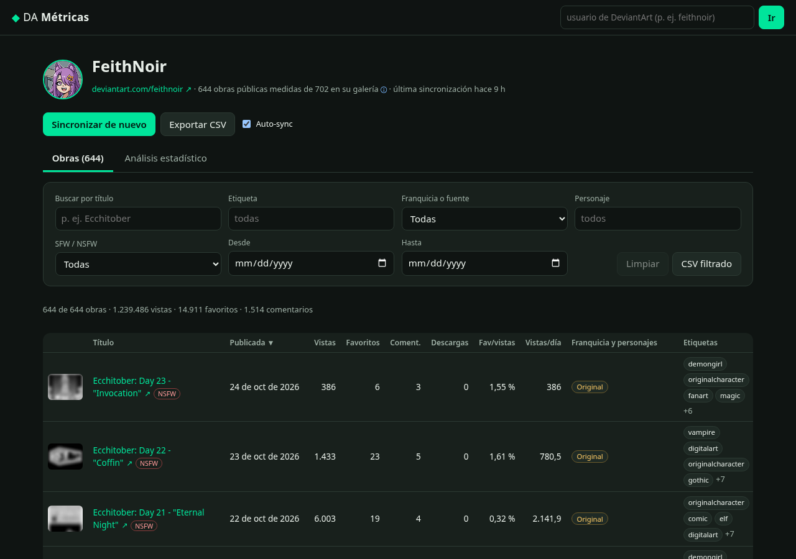
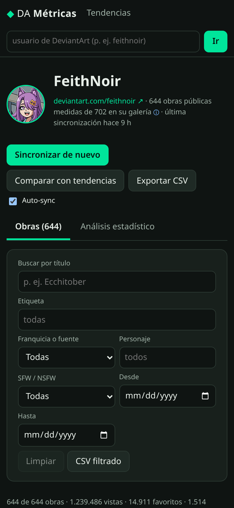
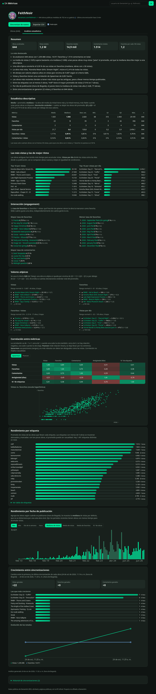
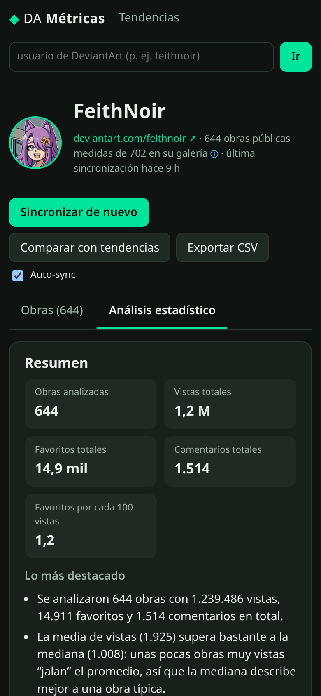
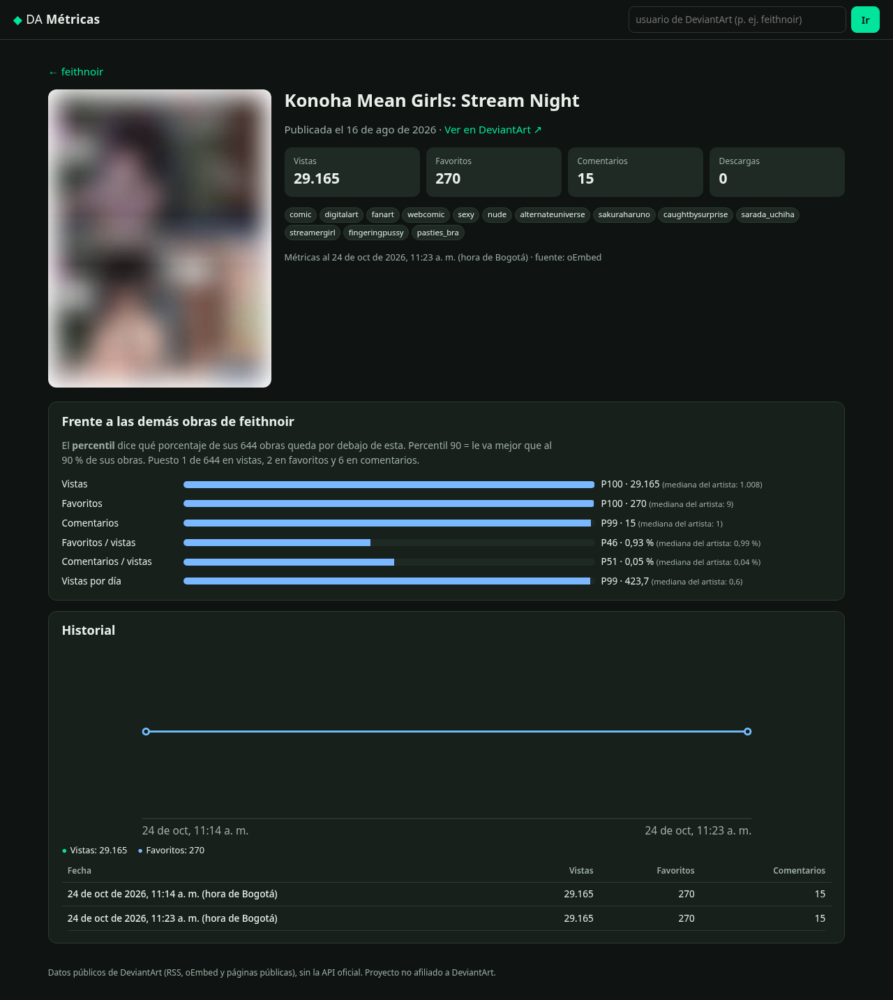
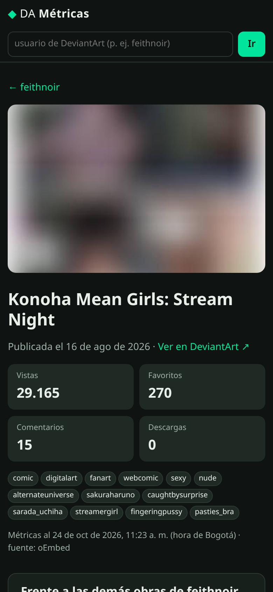

# DA Métricas

Aplicación full-stack para **medir el rendimiento público de las obras de un artista de DeviantArt**: sincroniza su galería, guarda un historial de métricas en SQLite y presenta un **análisis estadístico explicado en español sencillo** (descriptivos, interacción, atípicos, correlaciones, etiquetas, fechas, antigüedad y crecimiento).

Pensada para seguir la cuenta [feithnoir](https://www.deviantart.com/feithnoir), pero funciona con **cualquier usuario público**.
**No usa la API oficial de DeviantArt** (ni OAuth ni `api/v1/oauth2`): solo fuentes públicas, gratuitas y sin claves.

> Proyecto personal de **Feith Noir**: Angular 22 + Node.js 24 + TypeScript + Fastify + SQLite.

| Escritorio (1280 px) | Móvil (390 px) |
| --- | --- |
|  |  |
|  |  |
|  |  |
|  |  |

## Qué hace

- **Sincroniza** un usuario: recorre su galería pública y, para cada obra, guarda título, URL, miniatura, fecha de publicación, **favoritos (likes)**, **vistas**, **comentarios**, **descargas** y **etiquetas**.
- **Guarda un snapshot por obra en cada sincronización** (tabla `snapshots`), para analizar el crecimiento en el tiempo.
- **Sincronización automática** opcional (por defecto una vez al día; mínimo cada 6 horas, para no sobrecargar a DeviantArt).
- **Tabla de obras** ordenable y filtrable (título, etiqueta, rango de fechas) con enlaces al original y **exportación a CSV** (respeta los filtros).
- **Análisis estadístico** por artista y **detalle por obra** (percentiles frente a las demás obras, puesto, historial con gráfico).
- Estados claros de **carga, vacío y error**: avisa si el usuario no existe o no tiene obras públicas.

## Fuentes de datos (verificadas en vivo el 24 de octubre de 2026)

| Fuente | URL | Qué trae | Qué NO trae |
| --- | --- | --- | --- |
| **RSS público de la galería** | `https://backend.deviantart.com/rss.xml?type=deviation&q=gallery:USUARIO&offset=N` | Lista de obras: título, URL (con el id), fecha (`pubDate`), miniaturas, autor, clasificación (`media:rating`) | Estadísticas; las etiquetas (`media:keywords`) vienen casi siempre vacías |
| **oEmbed público** | `https://backend.deviantart.com/oembed?url=URL_DE_LA_OBRA` | `community.statistics._attributes`: **vistas, favoritos, comentarios, descargas**; **etiquetas** (`tags`), fecha (`pubdate`), título, autor | — |
| **Página pública de la obra** (respaldo) | `https://www.deviantart.com/USUARIO/art/...` | El JSON embebido `window.__INITIAL_STATE__` con `stats` (vistas, favoritos, comentarios, descargas) y etiquetas | Se usa solo si falla el oEmbed (pesa ~1 MB por obra) |
| **Página pública de la galería** | `https://www.deviantart.com/USUARIO/gallery` | Si el usuario existe (404 si no), nombre visible, avatar y el **total de la carpeta “All”** | — |

Cómo se combinan: **RSS** (lista completa, paginando con el enlace `rel="next"`) → **oEmbed** por obra (métricas + etiquetas) → **página de la obra** solo como respaldo. La galería HTML se pide una vez por sincronización para saber si el usuario existe y cuántas obras dice tener.

### Límites conocidos (sin inventar datos)

- **Contenido premium / de pago no es público**: el RSS no lo lista. Para feithnoir, la galería dice **702** obras en “All” y el RSS expone **644**; las 58 restantes son, sobre todo, carpetas “Patreon Imagenset” de pago. Esas obras **no se miden** (la interfaz muestra “644 de 702”).
- **Páginas del RSS irregulares**: el `offset` avanza de 60 en 60, pero cada página trae menos de 60 ítems (filtra lo no público). Por eso se sigue el enlace `rel="next"` en vez de contar ítems.
- **Las métricas son acumuladas** (totales a la fecha). No hay vistas por día oficiales: el crecimiento se calcula entre snapshots propios, así que solo existe desde tu segunda sincronización.
- **Miniaturas**: para obras para adultos, DeviantArt sirve miniaturas difuminadas a usuarios sin sesión; la app muestra lo que es público.
- **Descargas**: el oEmbed puede ir un poco por detrás de la página (se vio `downloads: 0` en oEmbed y `1` en la página para la misma obra).
- **No hay datos públicos de**: vistas por día, procedencia del tráfico, “privately collected” en oEmbed, ni seguidores ganados por obra.
- **Cloudflare**: desde el servidor de desarrollo no hubo bloqueos (RSS, oEmbed y HTML respondieron 200). Si DeviantArt presenta un desafío de Cloudflare, la app **lo detecta, detiene la sincronización y lo informa**: no intenta saltárselo.

## Respeto por DeviantArt

- **User-Agent descriptivo** (`da-metricas/1.0 (...)`, configurable con `USER_AGENT`).
- **Concurrencia 1–2** y **pausa mínima** entre peticiones (600 ms por defecto). Una galería de ~650 obras tarda unos 6–7 minutos, a propósito.
- **Reintentos con backoff exponencial** ante 429/403/5xx, respetando `Retry-After`.
- **Caché en SQLite** (30 min por defecto) para no repetir descargas en sincronizaciones seguidas; el RSS de la primera página y el oEmbed de cada sincronización se piden frescos para que los snapshots sean reales.
- **Sincronización automática como máximo cada 6 horas.**
- Lee únicamente información **pública**; no inicia sesión ni guarda credenciales. Revisa y respeta los [Términos de servicio de DeviantArt](https://www.deviantart.com/about/policy/service/); úsala para seguimiento personal y con moderación.

## Arquitectura

```
da-metricas/
├── server/                     # API Node.js 24 + TypeScript (Fastify) + SQLite (node:sqlite)
│   ├── src/
│   │   ├── parsers/            # rss.ts, oembed.ts, page.ts (__INITIAL_STATE__), text.ts
│   │   ├── http.ts             # cliente “amable”: UA, concurrencia, pausas, backoff, caché, Cloudflare
│   │   ├── deviantart.ts       # perfil, lista (RSS) y detalle (oEmbed → página)
│   │   ├── sync.ts             # orquesta la sincronización y guarda snapshots
│   │   ├── db.ts               # esquema y consultas SQLite
│   │   ├── stats.ts            # estadística pura: media, mediana, cuantiles, Pearson, Spearman, IQR…
│   │   ├── analysis.ts         # análisis por artista y por obra + frases en español
│   │   ├── scheduler.ts        # sincronización automática
│   │   ├── csv.ts              # exportación CSV (BOM UTF-8, anti-fórmulas)
│   │   ├── app.ts / index.ts   # rutas REST y arranque
│   │   └── cli-sync.ts, check-sources.ts
│   ├── data/da-metricas.db     # base SQLite (se crea sola; no se versiona)
│   └── test/                   # Vitest + fixtures reales recortadas
├── web/                        # Angular 22 (standalone, signals, sin zone.js), gráficos SVG propios
│   └── src/app/
│       ├── pages/              # inicio, artista (obras/análisis), detalle de obra, opciones
│       └── charts/             # barras, columnas, líneas y dispersión (sin librerías)
├── scripts/screenshots.mjs     # capturas con Playwright
└── .github/workflows/ci.yml    # lint, tests y build
```

Tablas SQLite: `artists`, `deviations`, `syncs`, `snapshots` (una fila por obra y sincronización), `settings` y `http_cache`.

## Requisitos e instalación

- Node.js **24** (usa el módulo integrado `node:sqlite`; no hay dependencias nativas).
- Chrome/Chromium solo para generar capturas.

```bash
npm install
npm run build          # compila Angular y el servidor
npm start              # http://localhost:3100 (sirve la API y la web)
```

Desarrollo con recarga: `npm run dev` (API en `:3100`, Angular en `:4300` con proxy a `/api`).

`npm start` es **multiplataforma** (Windows, Linux y macOS): el workspace `server` arranca con `node start.mjs`, que fija `NODE_ENV=production` sin depender de la sintaxis `VAR=valor` de shells Unix (que falla en `cmd.exe` de Windows).

### Scripts

| Script | Qué hace |
| --- | --- |
| `npm run dev` | API (tsx watch) + Angular dev server |
| `npm run build` | Compila web y servidor |
| `npm start` | Producción (Windows/Linux/macOS): API + web en el puerto `PORT` (3100) vía `server/start.mjs` |
| `npm test` | Tests del servidor (Vitest) y de la web (Angular + Vitest) |
| `npm run lint` | ESLint + `tsc --noEmit` |
| `npm run sync -- feithnoir` | Sincroniza un usuario desde la terminal |
| `npm run check:sources -- feithnoir` | Comprueba en vivo que RSS, oEmbed y la galería responden con el formato esperado |
| `npm run screenshots` | Regenera `docs/screenshots/` (con el servidor corriendo) |

### Variables de entorno

| Variable | Por defecto | Uso |
| --- | --- | --- |
| `PORT` / `HOST` | `3100` / `0.0.0.0` | Servidor |
| `DB_FILE` | `server/data/da-metricas.db` | Base SQLite |
| `USER_AGENT` | `da-metricas/1.0 (...)` | Cabecera enviada a DeviantArt |
| `DA_CONCURRENCY` | `2` (máx. 2) | Peticiones simultáneas |
| `DA_DELAY_MS` | `600` (mín. 250) | Pausa mínima entre peticiones |
| `DA_MAX_RETRIES` | `4` | Reintentos ante 429/403/5xx |
| `CACHE_TTL_MINUTES` | `30` | Vida de la caché HTTP |
| `TZ_ANALYSIS` | `America/Bogota` | Zona para agrupar por mes, día y hora |

## API REST

| Método y ruta | Descripción |
| --- | --- |
| `GET /api/health` | `{ ok: true }` |
| `GET /api/artists` | Artistas guardados con su número de obras |
| `GET /api/artists/:usuario` | Artista, si hay una sincronización en curso y las últimas 10 sincronizaciones. `404` si aún no hay datos |
| `PATCH /api/artists/:usuario` | `{ "autoSync": true \| false }` |
| `POST /api/artists/:usuario/sync` | Inicia (o reutiliza) una sincronización. Responde `202` con el registro `sync` |
| `GET /api/syncs/:id` | Progreso: `status` (`running`, `ok`, `partial`, `error`, `not_found`, `empty`), `phase`, `found`, `processed`, `failed`, `message` |
| `GET /api/artists/:usuario/deviations?q=&tag=&from=&to=&sort=&order=` | Obras con sus últimas métricas, `favRate`, `commentRate` y `viewsPerDay`. `from`/`to` en `AAAA-MM-DD` (hora de Bogotá); `sort`: `publishedAt`, `views`, `favourites`, `comments`, `downloads`, `favRate`, `viewsPerDay`, `title` |
| `GET /api/artists/:usuario/analysis` | Análisis completo (ver abajo) |
| `GET /api/artists/:usuario/export.csv?…` | CSV con los mismos filtros |
| `GET /api/deviations/:id` | Obra, historial de snapshots y posición frente a las demás obras del artista |
| `GET /api/settings` / `PUT /api/settings` | Auto-sync: `{ enabled, intervalHours }` (6–168 h). Errores `400` en español |

## Notas del método estadístico

- **Solo obras con métricas** entran en el análisis. Cada métrica usa el último snapshot.
- **Descriptivos**: media, mediana, **desviación estándar muestral** (n − 1), mínimo, máximo, **cuartiles por interpolación lineal** (tipo 7, el de Excel/R/NumPy) e IQR. Las vistas son muy asimétricas, así que la interfaz destaca la **mediana**.
- **Tasas de interacción**: favoritos ÷ vistas y comentarios ÷ vistas, **solo para obras con ≥ 30 vistas** (evita tasas engañosas con muestras diminutas).
- **Atípicos**: vallas de **Tukey** (Q1 − 1,5·IQR, Q3 + 1,5·IQR) sobre vistas, favoritos, tasa de favoritos y vistas por día; se reporta además el **z-score**.
- **Correlación**: **Pearson** (lineal) y **Spearman** (por rangos, con empates promediados) entre vistas, favoritos, comentarios, antigüedad y número de etiquetas. Correlación no implica causalidad.
- **Etiquetas**: media y mediana de vistas/favoritos por etiqueta. Se descartan etiquetas con 1 sola obra y se marcan como **“muestra pequeña”** las que tienen menos de 5.
- **Fechas**: agrupación por mes, año, día de la semana y hora **en hora de Bogotá**. Ojo: los periodos recientes tienen obras con menos tiempo para acumular vistas.
- **Normalización por antigüedad**: vistas (y favoritos) **por día desde la publicación**, con mínimo 1 día.
- **Crecimiento**: diferencia entre el primer y el último snapshot de cada obra, y serie temporal de totales por sincronización terminada.
- **Percentil de una obra**: porcentaje de las obras del artista con un valor menor (los empates cuentan la mitad).

## Resultados reales con feithnoir

Primera sincronización real (24 de octubre de 2026, ~11:14 a. m. hora de Bogotá): **644 obras públicas** (de 702 en la galería), **644/644 con métricas** y 0 fallos, en 395 s.

- Totales: **1.239.464 vistas**, **14.911 favoritos**, **1.514 comentarios**, 333 descargas.
- Top 3 por vistas: *Konoha Mean Girls: Stream Night* (29.165), *RWBY - Kali at Beach* (27.909), *RWBY - Thorns and Crowns* (24.066).
- Vistas por obra: mediana **1.008**, media 1.925 (desv. 2.820): pocas obras muy vistas inflan la media.
- Una obra típica convierte el **0,99 %** de sus vistas en favoritos (mediana).
- Vistas y favoritos: Spearman **0,89** (Pearson 0,82). Las obras más **recientes** tienden a tener **más** vistas (Spearman vistas–antigüedad −0,51).
- Una segunda sincronización ~9 minutos después (644/644, 0 fallos) dejó el primer historial: +22 vistas, sobre todo en las entradas más nuevas de Ecchitober.

## Tests

- **Servidor (Vitest)**: parsers con **fixtures de respuestas reales** recortadas (`server/test/fixtures`), funciones estadísticas con valores conocidos, cliente HTTP (reintentos, Cloudflare, caché, concurrencia), análisis, CSV y rutas de la API con un DeviantArt simulado a partir de las fixtures (incluye el respaldo HTML, usuario inexistente y usuario sin obras).
- **Web (Angular + Vitest)**: formato es-CO, tabla de obras (filtros, orden, etiquetas, CSV), página de artista (carga, vacío, usuario inexistente, error) y gráficos.

## Licencia

MIT. Proyecto no afiliado a DeviantArt; “DeviantArt” es marca de sus respectivos dueños.
